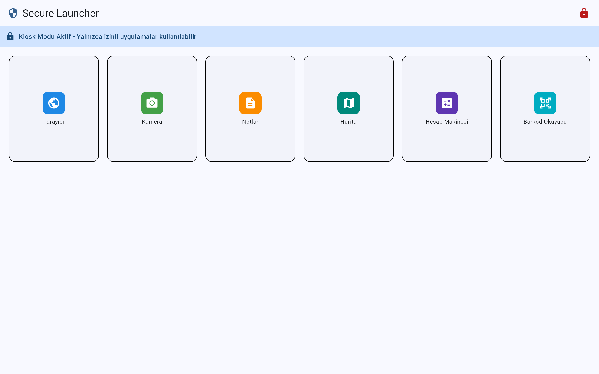
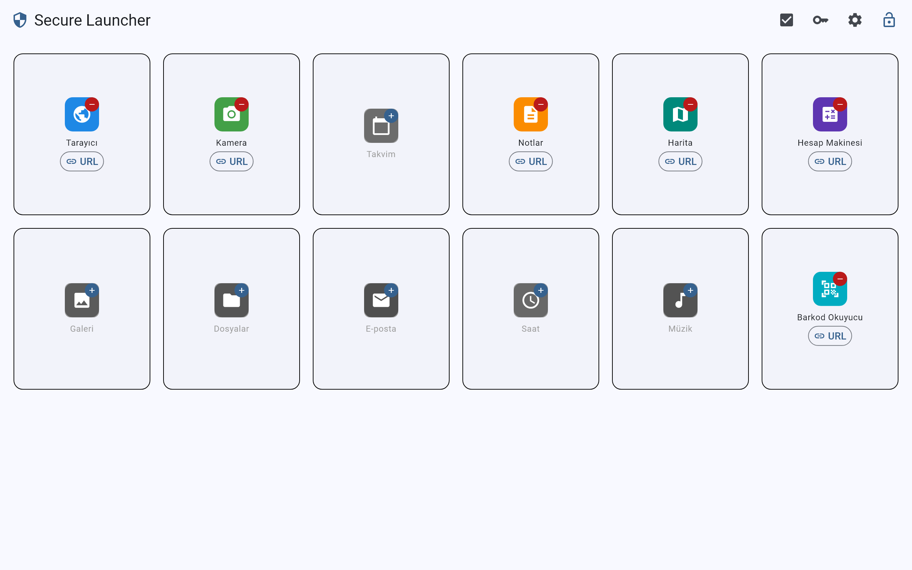
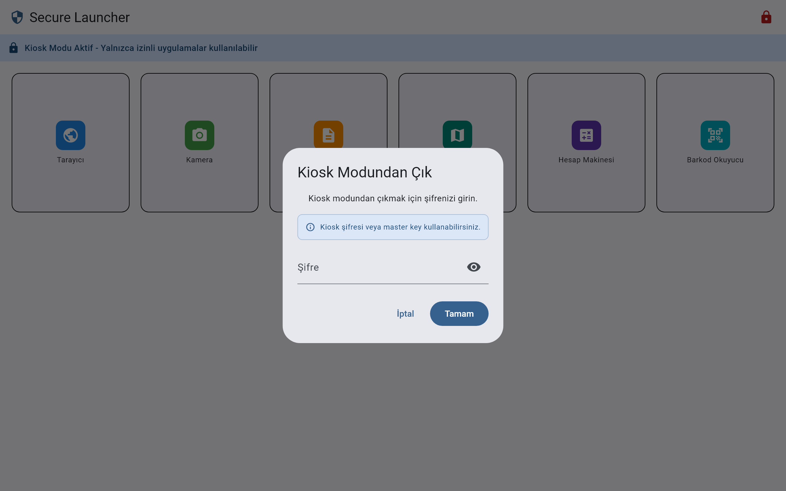
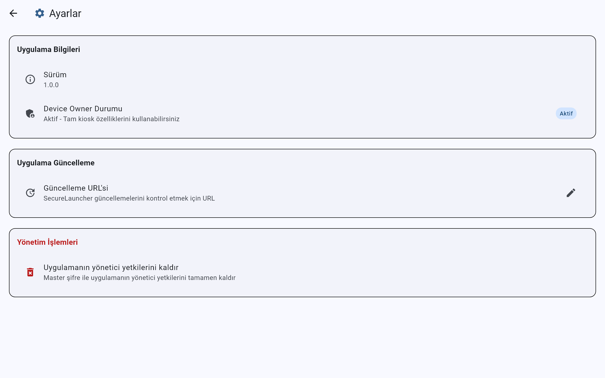

# SecureLauncher

**An Android kiosk launcher built with Flutter and Kotlin.** It locks a device down to a chosen set of apps — for shared tablets, info screens and field devices — and can update the apps it manages over the air.

[Türkçe aşağıda](#türkçe)

## Screenshots

| Kiosk mode | Choosing allowed apps |
|---|---|
|  |  |
| **Password-protected exit** | **Settings** |
|  |  |

<sub>Rendered from the app's own widgets in a Flutter test on a 1280×800 tablet layout. The app list and icons are demo data.</sub>

## Features

- **Kiosk mode** with Android Lock Task (screen pinning); full lockdown when the app is the **Device Owner**.
- **Home launcher** — replaces the home screen, so the Home button always returns to the kiosk.
- **Allowed apps** — choose which installed apps can be opened; they are shown in a grid.
- **Password-protected exit** — the kiosk password is stored only as a salted SHA-256 hash.
- **Auto-start on boot** — a `BootReceiver` brings the device back into kiosk mode after a restart.
- **Over-the-air updates** — reads an update manifest (JSON) from a URL, downloads the APK with a progress dialog and installs it.
- **Navigation bar hiding** and an admin-only uninstall flow.
- Material 3 UI.

## Architecture

Flutter handles the UI and app logic; device-level features live in Kotlin and are exposed through a `MethodChannel`:

| Layer | Files | Responsibility |
|---|---|---|
| UI | `lib/screens/`, `lib/widgets/` | Home grid, settings, password and update dialogs |
| Services | `lib/services/` | Password hashing, preferences, update checks and downloads (`dio`), platform bridge |
| Android (Kotlin) | `MainActivity.kt` | Lock Task, Device Owner checks, launching apps, listing launchable apps, setting the default home app, installing APKs |
| Android (Kotlin) | `MyDeviceAdminReceiver.kt`, `BootReceiver.kt` | Device admin receiver, start on boot |

## Getting started

Requirements: Flutter SDK (Dart ≥ 3.7), Android SDK, an Android device (API 21+).

```bash
flutter pub get
flutter run
```

### Master key

The master key unlocks admin actions (removing device-admin rights and uninstalling). Only its SHA-256 hash is stored in the app. Before building, put the hex hash of your own master key in:

- `lib/services/master_key_service.dart` → `_masterKeyHash`
- `android/app/src/main/kotlin/.../MainActivity.kt` → `expectedHash`

```bash
# example: print the SHA-256 of a key
printf '%s' 'your-master-key' | sha256sum
```

### Release signing

Signing keys are not part of the repository. Create your own keystore and an `android/key.properties` file (both are git-ignored) as described in the [Flutter docs](https://docs.flutter.dev/deployment/android#sign-the-app).

### Device Owner (recommended for full lockdown)

Device Owner can only be set on a device with no Google accounts, usually right after a factory reset:

```bash
adb shell dpm set-device-owner com.erkayteknoloji.securelauncher/.MyDeviceAdminReceiver
```

Without Device Owner, enable **Settings → Security → Screen pinning** and confirm the system prompt when entering kiosk mode.

## Usage

1. Open the app and set the kiosk password.
2. Select the apps that should be available.
3. Tap the lock icon → **Enter kiosk mode**. To exit, tap the lock icon and enter the password.

## Tech stack

Flutter · Dart · Kotlin · Android Device Policy / Lock Task APIs · `MethodChannel` · `dio` · `shared_preferences` · `crypto`

## License

MIT

---

## Türkçe

**Flutter ve Kotlin ile geliştirilmiş Android kiosk launcher'ı.** Cihazı seçilen uygulamalarla sınırlar; ortak kullanılan tabletler, bilgi ekranları ve saha cihazları için. Yönettiği uygulamaları uzaktan güncelleyebilir.

Ekran görüntüleri için yukarıdaki [Screenshots](#screenshots) bölümüne bakın (uygulama listesi ve ikonlar demo veridir).

- Android Lock Task ile kiosk modu; uygulama **Device Owner** olduğunda tam kilit.
- Ana ekran (HOME) launcher'ı; izin verilen uygulamalar ızgarada listelenir.
- Kiosk çıkışı şifreyle korunur; şifre yalnızca tuzlu SHA-256 hash olarak saklanır.
- Cihaz yeniden başlayınca kiosk moduna otomatik döner.
- URL'deki JSON üzerinden güncelleme kontrolü, ilerleme göstergeli APK indirme ve kurulum.

Çalıştırma: `flutter pub get` ve `flutter run`. Device Owner kurulumu için yukarıdaki `adb` komutuna bak.
